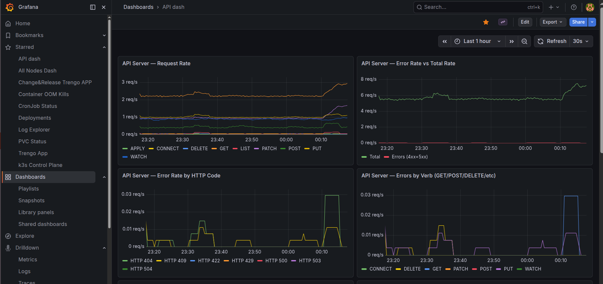
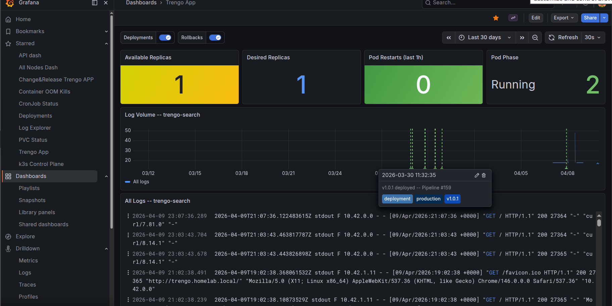
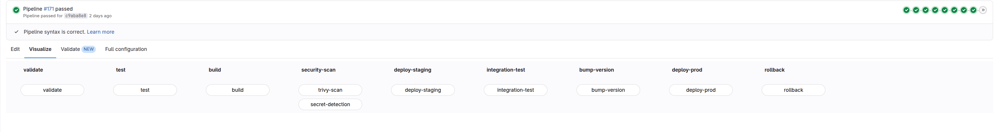
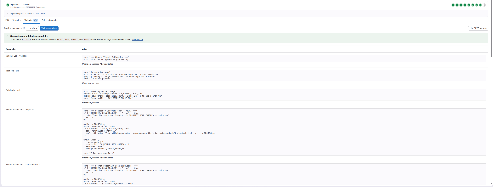
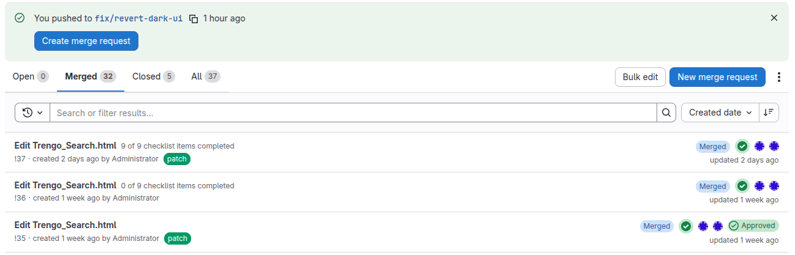
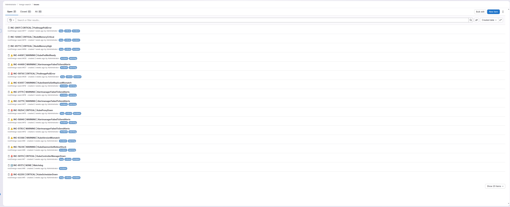
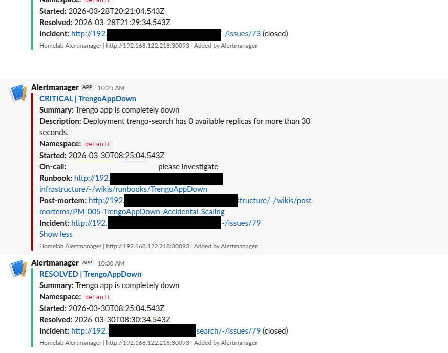
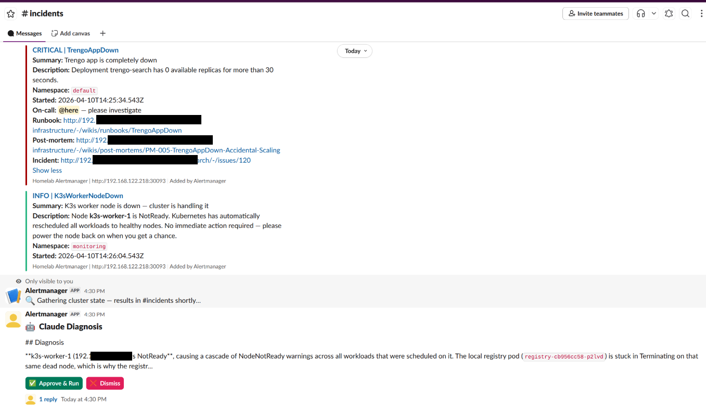
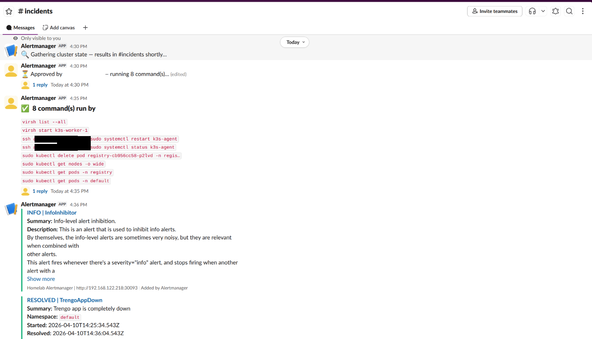

# homelab-infrastructure

A self-hosted DevOps lab running on KVM/libvirt. Everything is defined as code — VMs, cluster config, monitoring, CI/CD pipelines, and alerting.

> **Highlight:** This lab includes a working Claude AI auto-healing system — when an alert fires, Claude diagnoses the root cause in real time and posts a one-click fix to Slack. No scripts, no runbook lookup, no SSH-ing into nodes. See [Alerting & Claude AI Auto-healing](#alerting--claude-ai-auto-healing) below.

---

## What this demonstrates

- **Full infrastructure-as-code lifecycle** — VM provisioning through Terraform, configuration via Ansible, a kubeadm Kubernetes cluster bootstrapped by Ansible roles
- **Production-grade observability** — Prometheus, Grafana, Loki (31-day retention), Alertmanager with 20+ custom alert rules
- **Complete incident management pipeline** — alert fires → Slack notification with runbook link → GitLab issue auto-created → auto-closed on resolution
- **GitOps CI/CD** — lint, validate (kubeconform + promtool), security scan (gitleaks + kubesec), deploy, smoke test stages
- **Automated backups** — etcd snapshots every 12h, Vaultwarden SQLite hot-copy daily, GitLab full backup daily; all retained with configurable history
- **Security hardening** — NetworkPolicy default-deny, least-privilege ServiceAccounts, immutable CI tool images, PodDisruptionBudgets, pod anti-affinity, pinned SSH host keys
- **Self-healing automation** — crashloop recovery and image-prune CronJobs, cluster drift detection against the hypervisor
- **Claude AI auto-healing** — Alertmanager fires → Claude reads live cluster state → diagnoses root cause → one-click Approve in Slack executes the fix automatically
- **Runbook library** — 14 runbooks covering control plane, nodes, storage, applications, monitoring, and full disaster recovery with RTO/RPO targets

---

## Screenshots

**Cluster & App**

| API dashboard | Trengo app |
|---|---|
|  |  |

**CI/CD & GitLab**

| Pipeline visualized | Pipeline validation with job code | Merge requests with checklists | GitLab Issues from Alertmanager |
|---|---|---|---|
|  |  |  |  |

**Alerting**

| Slack alert |
|---|
|  |

**Claude AI Auto-healing**

| Claude diagnosis in Slack | One-click auto-heal approved and resolved |
|---|---|
|  |  |

---

## What's in here

| Layer | Tech |
|---|---|
| VM provisioning | Terraform + libvirt provider |
| Configuration management | Ansible (kubeadm bootstrap, add-ons and workloads as roles) |
| Container orchestration | kubeadm Kubernetes 1.33, containerd, Calico, etcd |
| Load balancing / ingress | MetalLB (L2) + Traefik, `*.homelab.local` hostnames |
| CI/CD | GitLab CE (self-hosted) + `.gitlab-ci.yml` |
| Monitoring | Prometheus + Grafana + Loki (31d retention) + Alertmanager |
| Alerting | 20+ custom rules, auto-diagnosis via Claude AI |
| Incident management | Slack + GitLab Issues (auto-open/close) + runbooks |
| Backups | etcd, Vaultwarden, GitLab — CronJobs |
| Secrets | Vaultwarden (self-hosted) |
| Registry | Local Docker registry — NFS-backed persistent storage |
| Security | NetworkPolicy, RBAC, image SHA pinning, PodDisruptionBudgets |

---

## Cluster layout

```
Host machine (KVM/libvirt, 32GB RAM)
├── kubeadm-control   .240   2 vCPU / 2GB   control plane (API server, etcd, scheduler, controller-manager)
├── kubeadm-worker-1  .241   2 vCPU / 2GB   workloads
├── kubeadm-worker-2  .242   2 vCPU / 2GB   workloads
├── infra VM          .230   2 vCPU / 3GB   NFS server (/data) + GitLab CE — outside the cluster
└── ci-runner         .220                  GitLab shell runner — outside the cluster
```

All IPs are in the default libvirt NAT range (`192.168.122.0/24`). The node addresses come from `control_ip`, `worker_count` and `worker_ip_offset` in `terraform-kubeadm/terraform.tfvars`; MetalLB hands out `.200-.217` to `LoadBalancer` services, with Traefik on `.200`.

Additional workers are added by raising `worker_count` and re-running the worker play. GitLab runs on the infra VM; CI jobs execute on the dedicated `ci-runner` VM.

> **Known limitation:** All VMs run on a single KVM host. This is intentional for a homelab but means the physical host is a single point of failure. Full recovery from host loss is documented in the [disaster recovery runbook](docs/runbooks/disaster-recovery/).

---

## Repo structure

```
terraform-kubeadm/   kubeadm node VMs; writes ansible/inventory/kubeadm.ini
terraform/           the infra VM (NFS + GitLab)

ansible/
  inventory/         kubeadm.ini (generated), infra.ini, pinned known_hosts
  playbooks/         kubeadm-bootstrap, kubeadm-addons, kubeadm-workloads, hardening
  roles/             k8s_common, k8s_control, k8s_worker, k8s_addons, k8s_workloads

kubernetes/
  deployments/       app manifests (registry, pylab, trengo-search, vaultwarden, webhook...)
  backup/            CronJobs — etcd snapshot, Vaultwarden, GitLab
  monitoring/        cluster drift check, lab network ConfigMap template
  policies/          NetworkPolicies (default-deny), PodDisruptionBudgets
  self-healing/      crashloop recovery, failed-job cleanup, node image prune

monitoring/
  values/            Helm values — kube-prometheus-stack, Loki, promtail
  grafana/
    homelab-alerts.yaml        20+ custom Prometheus alert rules
    homelab-silences.yaml      upstream rules silenced on purpose
    grafana-dashboard-*.yaml   per-service Grafana dashboards

docs/
  runbooks/          14 runbooks — control plane, nodes, storage, apps, DR with RTO/RPO table
  postmortems/

scripts/
  webhook.py                Alertmanager → Claude AI → Slack → GitLab incident bridge
  sync-webhook-configmap.py keeps the webhook ConfigMap identical to webhook.py
  kubeadm-known-hosts.sh    pins VM + hypervisor SSH host keys via the QEMU guest agent
  deploy.sh                 build, push and roll the trengo-search app
  sync-dashboards.sh        Grafana dashboards → ConfigMaps

tests/
  test_webhook.py   unit tests — command allowlist/blocklist, Slack signature verification
```

---

## Getting started

### Prerequisites

- KVM/libvirt on the host
- Terraform >= 1.0
- Ansible >= 2.12
- `kubectl`, `virsh` on PATH

### 1. Provision VMs

```bash
cp terraform-kubeadm/terraform.tfvars.example terraform-kubeadm/terraform.tfvars
# edit terraform.tfvars — set your SSH public key and desired worker count
cd terraform-kubeadm
terraform init && terraform apply          # writes ../ansible/inventory/kubeadm.ini
../scripts/libvirt-reserve-lab-range.sh    # keep libvirt DHCP below .200
../scripts/kubeadm-known-hosts.sh          # pin host keys of the VMs and the hypervisor
```

The infra VM (NFS + GitLab) has its own root in `terraform/`.

### 2. Bootstrap the cluster

```bash
cd ansible
ansible-galaxy collection install -r requirements.yml
ansible-playbook -i inventory/kubeadm.ini playbooks/kubeadm-bootstrap.yml   # containerd, kubeadm init/join, Calico
ansible-playbook -i inventory/kubeadm.ini playbooks/kubeadm-addons.yml      # MetalLB, Traefik, NFS provisioner, registry
```

### 3. Deploy monitoring and the apps

```bash
ansible-playbook -i inventory/kubeadm.ini playbooks/kubeadm-workloads.yml
```

The play installs kube-prometheus-stack, Loki and Promtail from `monitoring/values/`, applies Vaultwarden, pylab, trengo-search and Portainer with their ingresses, the backup CronJobs and the network policies. Point `grafana`, `prometheus`, `alertmanager`, `vault` and `portainer.homelab.local` at the Traefik address (`192.168.122.200`) in `/etc/hosts` or the lab DNS. See [`ansible/README.md`](ansible/README.md) for the full add-on list and the manual steps (lab network ConfigMap, webhook, drift check).

---

## Secrets

Secrets (`GITLAB_TOKEN`, ...) are pulled from environment variables or Vaultwarden via the Bitwarden CLI. See `scripts/load-secrets.sh` for the bootstrap flow and `scripts/setup-vault.sh` to seed Vaultwarden from scratch.

The secret rotation procedure for all cluster secrets is documented in [`docs/runbooks/applications/secret-rotation.md`](docs/runbooks/applications/secret-rotation.md). No real-valued Secret manifests are committed — in-cluster secrets are created from the `.yaml.example` templates (`grafana-gitlab-secret.yaml.example`, `pylab-secrets.yaml.example`...) and never committed with real values. The webhook additionally requires an `alertmanager-token` Secret (`ALERTMANAGER_TOKEN`, sent by Alertmanager as a bearer token) — the alert endpoint is fail-closed without it. Node join tokens are short-lived and minted by `kubeadm` when a worker joins; nothing is stored.

---

## Backups

All stateful components are backed up automatically via Kubernetes CronJobs defined in `kubernetes/backup/`.

| What | How | Schedule | Retention |
|---|---|---|---|
| Cluster state (etcd) | `etcdctl snapshot save` from a job on the control node, written to NFS | Every 12h | 14 snapshots |
| Vaultwarden | `sqlite3 .backup` from NFS-mounted PVC | Daily 02:00 | 30 days |
| GitLab (repos, issues, CI, wikis) | `gitlab-backup create` via SSH | Daily 03:00 | 7 backups |

Restore procedures for each component are documented in the [runbooks](docs/runbooks/).

**RPO:** ≤ 12h for cluster state, ≤ 24h for application data.
**RTO:** ~2h for full cluster rebuild from scratch (documented in disaster recovery runbook).

---

## Security

**NetworkPolicy** — default-deny applied in all namespaces. Explicit allow-rules cover Traefik ingress, inter-namespace registry pulls, and Prometheus scrape paths. Policies live in `kubernetes/policies/`.

**RBAC** — each workload has a dedicated ServiceAccount with least-privilege roles. `automountServiceAccountToken: false` is set by default; tokens are only mounted where explicitly required. The `webhook.py` ServiceAccount is scoped to read-only pod/node access; command execution is routed via SSH with a dedicated key, not via the Kubernetes API.

**Supply-chain controls** — CI validation and deployment tools use immutable SHA256 image digests. Kubernetes packages are pinned to an exact version by the Ansible roles. Critical third-party workloads such as Vaultwarden are digest-pinned; locally built application images remain an explicit exception and are tracked as future hardening work.

**PodDisruptionBudgets** — applied to Traefik and pylab to prevent accidental full-cluster downtime during rolling updates.

**Webhook security** — Every inbound route is authenticated and fail-closed. Slack requests (`/slack/lab`, `/slack/actions`) require a valid `SLACK_SIGNING_SECRET` HMAC — a missing secret rejects requests instead of trusting them, and the deployment marks the secret as required. The Alertmanager endpoint (`POST /`) requires a bearer token (`ALERTMANAGER_TOKEN`, sent by Alertmanager via `webhook_configs` `http_config` authorization); without a token configured the endpoint rejects everything rather than accept unauthenticated traffic — the ngrok tunnel therefore cannot be used to trigger remediation anonymously. Unknown paths return 404. Approve & Run is additionally gated by `SLACK_APPROVERS`, a comma-separated allowlist of Slack user IDs (`U…`, usernames are accepted but can be changed by their owner); users outside the list are denied, and the attempt is logged. The webhook endpoint is reachable from the internet only through the ngrok tunnel.

**LLM command hardening** — Claude's suggested commands are parsed server-side: only `kubectl`, `ssh`, `virsh` and `docker` commands pass (an `ssh` line must be `ssh [user@]host command`, SSH options such as `ProxyCommand` are rejected), shell metacharacters (`;`, `|`, `&`, `<`, `>`, backticks, `$(`) are rejected, and reads of secrets, private keys, kubeconfigs and `kubeadm token` output are blocked — independently of what the prompt asks for. Defense in depth: the prompt forbids it, the parser enforces it. Longer term: replace free-form commands with structured action IDs validated against trusted remediation scripts (tracked in Known limitations).

**SSH host-key pinning** — the Ansible inventories and the auto-healing webhook verify SSH host keys (`StrictHostKeyChecking=yes`) against pinned keys. Keys are read out-of-band through the QEMU guest agent (`scripts/kubeadm-known-hosts.sh`), so a rogue host on the libvirt bridge cannot substitute its own key. The script also pins the hypervisor's own keys, and the resulting file is mounted into the webhook pod as `/root/.ssh/known_hosts` (`SSH_KNOWN_HOSTS`). The webhook ConfigMap is generated from `scripts/webhook.py` by `scripts/sync-webhook-configmap.py`, and CI fails if the two drift apart.

**Remediation success is exit-code based** — SSH remediation results are classified by the remote exit code (timeouts map to 124), not by grepping output for the word "error"; failed remediation is reported as failed.

**Address allocation guardrails** — the MetalLB pool (`.200-.217`) is disjoint from all static lab addresses (`.220`, `.230`, `.240+`) and from the libvirt DHCP range (ends at `.199`, see `scripts/libvirt-reserve-lab-range.sh`). `scripts/validate-ip-allocations.py` fails CI on any overlap, and `scripts/sync-webhook-configmap.py --check` fails CI if the ConfigMap copy of `webhook.py` drifts from `scripts/webhook.py` (the same script without `--check` regenerates it) (the deployed copy is the ConfigMap — drift would silently deploy unhardened code).

**Secret rotation** — documented procedure for rotating all cluster secrets: `docs/runbooks/applications/secret-rotation.md`.

---

## Alerting & Claude AI Auto-healing

Most homelabs (and plenty of production setups) stop at "alert fires → someone gets paged". This goes further: when an alert fires, Claude AI reads the live cluster state, diagnoses the root cause, and posts a fix to Slack with a single **Approve & Run** button. One click and the remediation runs automatically — rebuilding missing images, restarting VMs, rolling back deployments — without ever opening a terminal.

Built entirely with open components: Prometheus, Alertmanager, a custom Python webhook, the Anthropic API, and Slack's Block Kit interactive messages. No third-party incident management platform required.

### How it works

```
Prometheus alert fires
       ↓
Alertmanager → webhook.py
       ↓
GitLab issue auto-created (with severity, runbook link, timeline)
       ↓
Slack notification posted (#incidents for critical/warning)
       ↓
Claude gathers live cluster state (nodes, unhealthy pods, events, registry)
       ↓
Claude posts compact diagnosis (2-sentence summary + Approve / Dismiss buttons)
Full diagnosis + suggested commands posted in thread
       ↓
Engineer clicks Approve & Run
       ↓
Commands execute automatically, routed to the right host:
  • virsh commands   → hypervisor (KVM host)
  • docker commands  → hypervisor (source code lives there)
  • kubectl commands → kubeadm-control over SSH
  • ssh commands     → direct from webhook pod
       ↓
Command output posted in thread
       ↓
Alert resolves → GitLab issue auto-closed → RESOLVED posted to Slack
```

### What Claude can fix automatically (one Approve click)

| Alert | Root cause Claude identifies | Fix Claude suggests |
|---|---|---|
| TrengoAppDown | Deployment scaled to 0, image pull failure, crashloop | `kubectl rollout restart`, `docker build/push` |
| PodImagePullError | Registry empty or unreachable | `docker build` + `docker push` from hypervisor source |
| WorkerNodeDown | VM powered off | `virsh start kubeadm-worker-N` |
| ClusterDrift | kubelet or containerd stopped on a running VM | `systemctl restart kubelet` over SSH |
| PodCrashLooping | OOM, bad config, missing secret | `kubectl describe`, log fetch, rollback |
| LocalRegistryDown | Registry pod crashed | `kubectl rollout restart deployment/registry` |
| NodeMemoryCritical | stress-ng or runaway process | `pkill`, service restart |
| NodeDiskHigh | Stale container images | `crictl rmi --prune` |

### Slack message design

Alerts and diagnoses are kept compact in the channel — full details expand in a thread:

- **Alert notification** — severity badge, summary, runbook link, GitLab incident link
- **Claude diagnosis** — 2-sentence summary + Approve & Run / Dismiss buttons in channel; full diagnosis + all commands in thread. Approve & Run honours the `SLACK_APPROVERS` allowlist — only listed engineers can execute remediation
- **Command output** — list of commands run in channel; full stdout/stderr in thread
- **Resolution** — RESOLVED notification with duration, incident link auto-closed

Alert rules live in `monitoring/grafana/homelab-alerts.yaml`. The webhook bridge is `scripts/webhook.py`; Alertmanager reaches it with a bearer token (`http_config.authorization` in `monitoring/values/kube-prometheus-stack.yaml`), and each alert is processed by its own status — a firing group can contain resolved alerts.

---

## Runbooks

14 runbooks in `docs/runbooks/` covering every alert category:

| Category | Runbooks |
|---|---|
| Control plane | API server down |
| Nodes | Worker not ready, cluster drift, memory pressure, disk full |
| Storage | NFS server down, PVC pending |
| Applications | Pod crashloop, image pull error, registry down, Trengo app down, secret rotation |
| Monitoring | Monitoring stack down, webhook receiver down |
| Disaster recovery | Full cluster recovery (RTO ~2h, RPO ≤24h) |

Each runbook includes: symptoms, immediate triage steps, root cause checklist, resolution steps, and a verification procedure.

---

## CI/CD

`.gitlab-ci.yml` stages run on the self-hosted GitLab runner VM. GitHub pull requests also run `.github/workflows/validate.yml`, giving the public mirror the same core syntax, Terraform, Kubernetes, Prometheus, and secret-leak checks.

| Stage | Tools | What it checks |
|---|---|---|
| lint | yamllint, ShellCheck, Python compile, `terraform fmt` | YAML/shell/Python syntax and Terraform formatting |
| validate | kubeconform, promtool, `terraform validate` | All deployable manifest schemas, alert rules, and both Terraform roots |
| security | gitleaks, kubesec, Snyk IaC | Secret leaks in the full change range and Kubernetes/IaC security findings |
| deploy | `kubectl apply`, `helm upgrade` | Applied to cluster — manual gate required on `main` |
| smoke test | curl, `kubectl rollout status` | Endpoint reachability, rollout completion |

Merge requests require a 9-point checklist and at least one approval before merge to `main`.

---

## Known limitations & future work

- **Single KVM host** — all VMs share one physical machine; host failure requires full rebuild (documented in DR runbook)
- **No GitOps operator** — cluster state is applied via CI/CD push rather than continuously reconciled by ArgoCD or FluxCD
- **Single control-plane node** — one etcd member, no HA; appropriate for this scale, and the etcd snapshots cover recovery
- **Plain HTTP ingresses** — the `*.homelab.local` hostnames have no TLS yet; Vaultwarden's web vault needs it (desktop/mobile clients work)
- **Free-form remediation commands** — approved commands are constrained by the operator allowlist + blocklist + metachar rejection, but the stronger design is structured action IDs with validated arguments mapped to trusted remediation scripts; tracked as future work

---

## License

MIT
